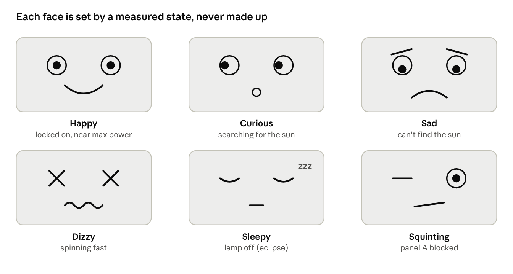

# ECE4760\_Mini-Sat Pet Spec

Snapshot of the live doc, 29 Oct 2026. Diagrams are screenshots; the live doc is linked in README.md.

## The idea

**Mini-Sat becomes a desk pet whose feelings are real measurements.** A small OLED screen on the satellite shows a face. It is happy when locked on the sun, sad when it can't find it, dizzy when it's spinning, and sleepy in an eclipse. Every mood is set by numbers the satellite actually measures, and every mood is checked by a test.

That keeps both goals:

- **For the team:** it's a cute, lovable desk pet you can poke, shade, spin and feed with light.
- **For avionics test engineering:** the face is a status indicator, the same as the warning lights on a spacecraft test panel. Our test stand checks that the indicator always shows the right state. The solar I-V curve, the maximum power point tracking, and the automated pass/fail catalogue all stay exactly as they were.

**Plain words:** the face is the satellite's telemetry, translated into a language anyone can read at a glance. A mood is never made up: if the face looks happy, there's a measured number that says it should.

## The faces

Six of the twelve moods, drawn as they could look on the 128×64 OLED. The eye on the blocked panel's side closes, so the face also shows which panel has the fault.

## Emotion map

Each flight mode and test causes one mood, set by a measured trigger, and each mood has a test that proves it shows up at the right time. Thresholds marked \_\_\_ come from our first measured runs.

| Situation | Mood | Face on the OLED | Measured trigger | Checked by |
| --- | --- | --- | --- | --- |
| Locked on the sun, panels near max power | Happy | Big eyes, smile | Sun hold mode and total power ≥ \_\_\_ % of the best from the I-V sweep | T07 sun hold |
| Searching for the sun | Curious | Eyes look left and right | Sun acquisition mode | T06 sun acquisition |
| Can't find the sun | Sad | Droopy eyes, frown | Still searching after \_\_\_ s | T06 (time-out case) |
| Spinning fast | Dizzy | Spiral eyes | Gyro rate > \_\_\_ °/s | T14 lost-in-space |
| Lamp off | Sleepy | Closed eyes, "zzz" | Eclipse mode | T08 eclipse |
| One panel blocked | Squinting | The eye on the blocked side closes | Panel fault flag for panel A or B | T09 shaded panel |
| Pushed off the sun | Grumpy, then relieved | Frown until back on target | Pointing error > \_\_\_ °, then < \_\_\_ ° | T07 pushes |
| Virtual battery low | Hungry | Open mouth, empty battery icon | Virtual battery < \_\_\_ % | T14 |
| I-V sweep running | Tasting | Licking lips, curve drawn under the face | I-V sweep in progress | T04 I-V sweep |
| MPPT at the peak | Content | Relaxed smile | Within \_\_\_ % of the I-V peak | T05 MPPT |
| Fault, wheel stopped | Worried | Wide eyes, sweat drop | Safe mode | IMU fault test |
| Just restarted by the watchdog | Confused | Question mark | Watchdog caused the last reboot | T10 watchdog |

**Bonus: the eyes look at the sun.** The pupils move left or right by the satellite's own sun-angle estimate, k · (P\_A − P\_B) / (P\_A + P\_B). That's cute, and it's also a live display of the sun sensor, so anyone can see when the estimate is wrong.

## Five more ways to give it personality

Each idea adds charm without losing the test-engineering story; most need little or no extra hardware.

### 1. Follow me: you are its sun

Swap the desk lamp for a bright flashlight in your hand. Walk around the bench and the satellite turns to watch you, like a pet following its owner.

- **Why it's cute:** it feels alive and loyal, and it's the best 10 seconds of the demo video.
- **Test value:** it's a moving-sun tracking test. The encoder measures how far behind you it lags while you walk, a real tracking-error number.
- **Extra hardware:** a bright LED flashlight. Check in week 1 that the small panels see it strongly enough at 30–50 cm.
- **Effort:** almost none; it's T07 with a moving light.

### 2. A voice: happy chirps and sad beeps

The satellite makes short sounds: a rising chirp when it finds the sun, a sad falling tone when it's lost, a snore in eclipse, an alarm in safe mode.

- **Why it's cute:** sound gives it a personality even when you're not looking at the screen.
- **Test value:** cockpits and test benches use alarm tones for warnings (the "master caution"). We can check each tone's frequency on the scope, which covers the report's "accuracy" item.
- **Extra hardware:** a small piezo buzzer driven by PWM on the satellite. Stretch: proper birdsong-style chirps on the ground station using an MCP4822 and our Lab 1 sound code.
- **Effort:** low; it reuses the Lab 1 DDS sound synthesis.

### 3. Hunger and feeding

The virtual battery becomes its stomach. It slowly gets hungry, and you "feed" it by giving it light. MPPT is "eating efficiently", and the screen shows how much energy it has eaten today.

- **Why it's cute:** it works like a Tamagotchi, so you have to look after it.
- **Test value:** this is a satellite power budget, energy in versus energy used, which real teams track for every mission. The I-V sweep becomes its "taste test".
- **Extra hardware:** none, since the virtual battery and the supply INA219 are already planned.
- **Effort:** low.

### 4. Vet check-up and a health certificate

The test catalogue becomes a check-up at the vet. Each test is one exam: eyes (sun sensor), heartbeat (reaction wheel), reflexes (push recovery), nutrition (I-V and MPPT), stamina (soak). At the end, the ground station shows a health certificate with every real measured number, and a sticker for each pass.

- **Why it's cute:** "Mini-Sat passed its check-up" is a lovely story for the video.
- **Test value:** this is literally an acceptance test report. Every real spacecraft board ships with one, and showing the total check-up time speaks to building satellites quickly.
- **Extra hardware:** none.
- **Effort:** low; it's the same test runner with friendlier names and a nicer report page.

### 5. A diary written from telemetry

The ground station turns logged events into diary lines with real numbers, for example: "It got dark. I held still and only drifted 1.8°. The sun came back and I found it in 2.4 s." (Those numbers are made-up examples.)

- **Why it's cute:** it tells its own story.
- **Test value:** event logging and anomaly review are a big part of test engineering. The diary is the soak-test summary in readable form.
- **Extra hardware:** none; a log kept in the ground station's memory and shown on VGA.
- **Effort:** medium; it needs a small event log and sentence templates.

## Ten more ideas

The three with the strongest avionics link are the wake-up self-test, the worried ground station and the wiggle dance; the rest are fun extras to pick from if there's time.

| # | Idea | What it does | Why it's cute | Test-engineering value | Extra hardware | Effort |
| --- | --- | --- | --- | --- | --- | --- |
| 6 | Wake-up self-test | At power-on it "stretches" one subsystem at a time (eyes open = IMU OK, wiggle = wheel OK, squint at the lamp = panels OK) before saying hello | Waking up like a pet in the morning | A power-on built-in test: every avionics box checks itself at start-up and reports what failed | None | Low |
| 7 | Worried ground station | The ground station gets its own face on VGA, a parent waiting for news. It gets worried when beacons stop, relieved when they return | A parent missing its baby | Link-loss detection and timing (T11), shown so anyone gets it | None | Low |
| 8 | Wiggle dance | A small happy back-and-forth wiggle with the reaction wheel when it locks on; a "no" shake when a command is refused | Body language, like a dog wagging | Proves fine small-angle control; the encoder measures the wiggle size and timing | None | Low |
| 9 | Petting | Tap the satellite gently and it giggles and wiggles. The MPU6050's accelerometer senses the tap | It reacts to touch | Event detection with a false-trigger test: taps must count, bumps from the wheel must not | None | Low |
| 10 | Mood light | An RGB LED changes colour with the mood: warm yellow when happy, blue when sleepy, red when worried | Glows with feeling | We drive the LED with our own PIO program, which is impressive for the course; the colour is checked against the mood ID | WS2812 RGB LED | Low–medium |
| 11 | Tricks on command | Pick a trick with the knob: "look left", "spin around", "sit" (hold still) | Teaching a pet tricks | Each trick is a commanded pointing test (T03) with measured accuracy | None | Low |
| 12 | Sunglasses | If the light is too strong (panel power above a high limit), it puts on sunglasses and grumbles | Funny and relatable | Over-limit protection, a real safety check on power systems | None | Low |
| 13 | Learns not to fear the dark | The first eclipse scares it. Each time, it measures the room's background light and adjusts its eclipse threshold, so it gets calmer | It grows up | Self-calibration from measurements, a real technique; the threshold history is logged | None | Medium |
| 14 | Bedtime routine | Before a scheduled eclipse in the soak test it yawns, and after one it stretches | Daily rhythm, like a pet | Shows the satellite follows a known orbit schedule; timing checked in T16 | None | Low |
| 15 | Level up | It earns points for each passed test and levels up, unlocking face accessories (a tiny hat at level 3) | Rewards for looking after it | Turns test coverage into something visible: how many tests are built and passing | None | Low |

## Chosen: the wake-up self-test

At power-on, Mini-Sat "stretches" one subsystem at a time before saying hello. This is a power-on self-test (built-in test), which every avionics box runs at start-up to report exactly what failed before it starts work.

| Step | The pet "stretches" | What it really checks | Pass if | If it fails |
| --- | --- | --- | --- | --- |
| 0 | Eyes closed, waking up | Why it restarted (normal or watchdog), boot counter | — | Watchdog restart: confused "?" face first |
| 1 | Opens its eyes | The IMU answers on I2C (ID register reads 0x68) and the gyro is steady while still | Gyro noise < \_\_\_ °/s | One eye stays shut, code IMU |
| 2 | Feels its tummy | All 3 INA219 power sensors answer; supply voltage in range | Supply between \_\_\_ and \_\_\_ V | Worried face, code PWR |
| 3 | Wiggles | Short wheel pulse each way; the gyro must see the platform twitch the opposite way | Twitch in the right direction, above \_\_\_ °/s | Shakes its head "no", code WHEEL |
| 4 | Squints at the lamp | Each panel's voltage with no load | Both above \_\_\_ V | Lamp off: "it's night", skipped, not failed. One panel low: code PANEL A or B |
| 5 | Says hello | Joins WiFi and sends a BOOT packet with every result | Ground station receives it | Keeps retrying; face stays "lonely" |

**Why step 3 matters:** checking that the platform turns opposite to the wheel catches motor wires connected backwards. With reversed wires the control loop would push the wrong way and spin the satellite up instead of steadying it.

**T20 Wake-up self-test (checks the self-test itself).** Real test engineers prove a self-test catches faults ("BIT coverage").

1. Normal start-up: every check passes and it says hello within \_\_\_ s.
2. Repeat with one fault planted before power-on: IMU unplugged, motor wires swapped, one panel covered, lamp off.
3. Pass if each fault gives exactly the right code and face, and nothing else fails.

Only plant faults with the power off. On the ground station, the BOOT packet becomes a "morning report card" listing each check with its measured number.

## Comparison

The OLED face, the vet check-up and the follow-me flashlight give the most charm and the most test-engineering value for the least work. Ratings are our own judgement, from 1 (low) to 3 (high).

| Idea | Cuteness | Test-engineering value | Effort | Extra hardware | Reuses |
| --- | --- | --- | --- | --- | --- |
| OLED face with moods | 3 | 3: a status indicator the tests verify | 2 | SSD1306 OLED | Lab 2 graphics ideas |
| 1. Follow me | 3 | 2: moving-target tracking error | 1 | Flashlight | T07 |
| 2. Voice | 2 | 2: alarm tones checked on the scope | 1 | Piezo buzzer | Lab 1 sound synthesis |
| 3. Hunger and feeding | 2 | 3: power budget, I-V as a taste test | 1 | None | Virtual battery |
| 4. Vet check-up | 2 | 3: acceptance test report | 1 | None | Test runner, VGA |
| 5. Diary | 2 | 2: event log, soak summary | 2 | None | VGA |

## Recommendation

Build the OLED face with moods, then add the vet check-up and the follow-me flashlight; add the voice if there's time and keep the diary as a stretch goal. Together these add about $10–15 of parts (an estimate) and one or two new tests.

**Extra hardware**

| Part | Connects to | Note |
| --- | --- | --- |
| SSD1306 OLED, 128×64, I2C (address 0x3C) | Satellite, I2C1 on GP14 (SDA) / GP15 (SCL) | Its own I2C bus, so a full-screen redraw never delays the sensor readings on GP8/GP9 |
| Piezo buzzer + series resistor | Satellite, a free PWM pin (e.g. GP16) | Only if we add the voice |
| Bright LED flashlight | — | For the follow-me demo |

**How the moods are chosen (the "mood engine")**

1. A small function looks at the flight mode and the latest measurements and picks one mood.
2. When two moods apply at once, a fixed order decides: worried, confused, dizzy, squinting, sleepy, hungry, sad, grumpy, curious, tasting, content, happy.
3. A mood stays on screen for at least 1 s, so the face doesn't flicker.
4. The mood's ID goes into every telemetry packet, so the ground station can check it.
5. The OLED is redrawn on core 1, so drawing never slows the control loop on core 0.

**New tests**

| ID | Test | How | Pass if |
| --- | --- | --- | --- |
| T17 | Mood mapping | The ground station creates each situation with commands it already has (point away, lamp off, inject faults, cover a panel), then reads the mood ID from telemetry | Every situation shows its expected mood within \_\_\_ ms |
| T18 | No false happiness | During a sun-hold run, compare every "happy" sample with the measured power | Happy is never shown below the power threshold |
| T19 | Health certificate | The vet check-up runs all built tests in a row and shows the certificate | All pass; total check-up time recorded |

**How to explain it**

- **To teammates:** it's a desk pet that loves the sun. You can spin it, shade it, feed it light and watch how it feels.
- **For avionics test engineering:** the face is a human-readable status indicator. Automated tests prove it never shows the wrong state, and the check-up is an acceptance test report. Underneath sit the same solar I-V curves, maximum power point tracking and pass/fail catalogue.
