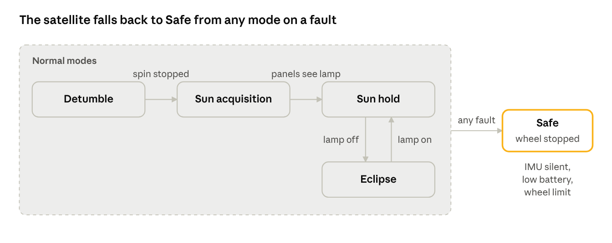
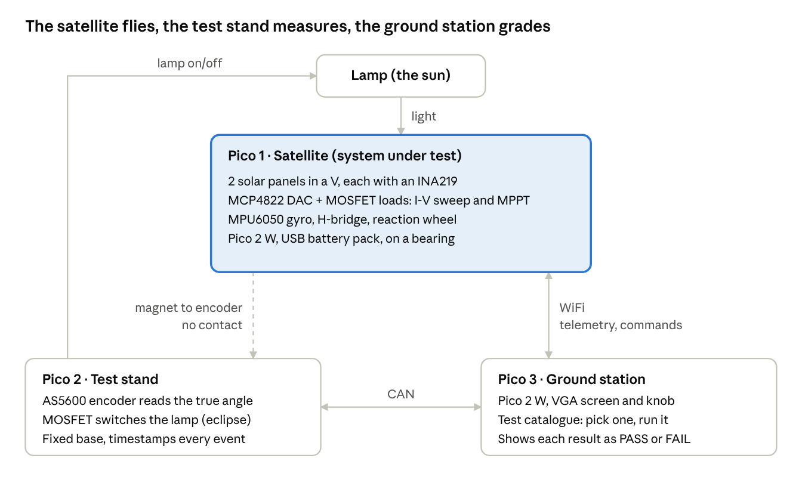
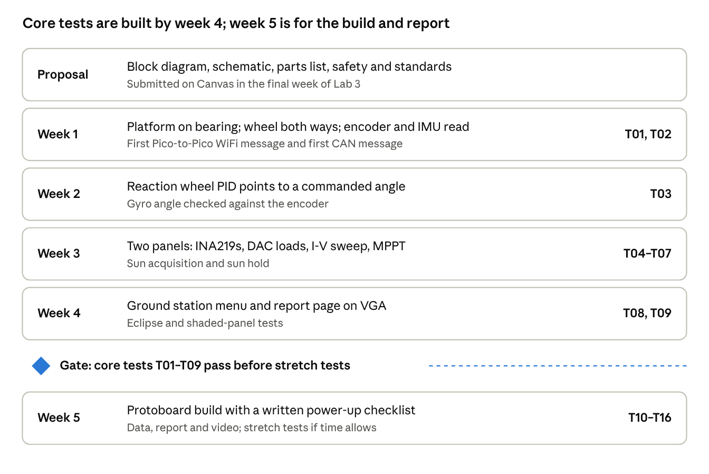

# ECE4760\_Mini-Sat Final Project Proposal

Snapshot of the live doc, 29 Oct 2026. Diagrams are screenshots; the live doc is linked in README.md.

## Project overview

**Sound bite:** Mini-Sat is a reaction-wheel satellite that turns two solar panels toward a lamp "sun" and keeps them at maximum power, checked by a Pico-based automated test stand that grades it test by test.

The system uses three Raspberry Pi Pico 2 boards and no laptop. A satellite on a low-friction turntable points itself by speeding up or slowing down a flywheel. Two solar panels mounted in a V act as both its power source and its sun sensor. A test stand under the turntable measures the true angle with a magnetic encoder and can switch the lamp off to make an "eclipse". A ground station with a VGA screen and a knob lets the user pick one test from a catalogue, runs it, and shows PASS or FAIL against limits we set.

**Rationale and inspiration.** After a real satellite is released from its rocket, its first job is to stop tumbling, find the Sun and get its panels charging. Satellite builders check this and many other behaviours on the ground with automated test equipment (ATE) before launch. We wanted to build both halves at desk scale: the spacecraft, and the test rig that proves it works. The reaction-wheel turntable idea comes from the common single-axis attitude-control demonstration used in science fairs and university labs. Our additions are the two-panel sun sensor, maximum power point tracking (MPPT), and a catalogue of independent automated tests.

**Team:** \[names and netIDs\]

## High-level design

Each Pico has one job: the satellite flies, the test stand measures, and the ground station decides PASS or FAIL. The satellite never grades itself.

| Pico | Where | Hardware | Job |
| --- | --- | --- | --- |
| 1. Satellite (Pico 2 W) | On the spinning platform, battery powered | MPU6050 IMU, 2 solar panels, 3 INA219 power sensors, MCP4822 DAC + 2 MOSFET loads, H-bridge, DC motor + flywheel, USB battery pack | Points at the lamp with the reaction wheel, runs MPPT on both panels, sends telemetry over WiFi |
| 2. Test stand (Pico 2) | Fixed base under the platform | AS5600 magnetic encoder, MOSFET lamp switch | Measures the true angle, switches the lamp (eclipse), timestamps events |
| 3. Ground station (Pico 2 W) | On the bench | VGA screen, rotary encoder with push button | Test catalogue menu, runs tests, live telemetry display, PASS/FAIL report |

**Two solar panels as a sun sensor.** The panels are mounted in a V, each tilted 30–45° away from the satellite's pointing direction. The panel facing the lamp more squarely makes more power, so the sign of the difference tells the satellite which way to turn. Dividing by the total cancels the lamp's brightness:

```latex
\theta_{sun} \approx k \cdot \frac{P_A - P_B}{P_A + P_B}
```

Both MPPT loops run before the panels are compared, so a difference means light, not a badly set load.

**MPPT on a dummy load.** For each panel, the DAC sets the gate voltage of a logic-level MOSFET in series with a power resistor. This sets how much current the panel must supply. An INA219 measures the panel's voltage and current. Sweeping the DAC gives an I-V curve. A perturb-and-observe loop then nudges the DAC and keeps whichever direction raised power. The energy is turned into heat rather than stored, so the satellite tracks battery charge with a software "virtual battery" that uses the measured panel power and the measured power the satellite consumes (third INA219).

**Flight modes.**

1. Detumble: the gyro reads the spin rate, and the wheel slows the platform to a stop.
2. Sun acquisition: slow sweep until both panels see light, then lock on.
3. Sun hold: keep the panels facing the lamp with the reaction wheel PID loop.
4. Eclipse: panel power drops, so the satellite holds its last heading with the gyro and enters low power.
5. Safe: on a fault (IMU silent, low virtual battery, wheel speed limit), stop the wheel and report why.



A normal start runs left to right; eclipses bounce between Sun hold and Eclipse, and any fault drops the satellite into Safe.

**User interface.** The ground station's VGA screen has three pages: a live page (encoder angle vs. the satellite's estimate, panel A and B power, wheel speed, mode), the test catalogue (turn the knob to select, press to run), and a report page (each test's measured value, limit and PASS/FAIL). Colours are never the only signal: every result is also written as the word PASS or FAIL.

## Test catalogue

Every test is a separate entry the user selects and runs from the ground station, so we can build and demonstrate them one at a time. Tests not written yet appear greyed out as NOT BUILT. Limits marked \_\_\_ are set after our first measured runs.

Step-by-step instructions for each test: [test-procedures.md](test-procedures.md)

Each test follows the same four steps and returns the same result record (name, measured value, limit, units, PASS/FAIL, run time):

1. Setup: put the system in a known starting state.
2. Stimulus: do the one thing being tested.
3. Measure: collect the numbers from the encoder and telemetry.
4. Evaluate: compare with the limits and record PASS or FAIL.

| ID | Test | Stimulus | Pass if | Priority |
| --- | --- | --- | --- | --- |
| T01 | Link check | Ping satellite (WiFi) and test stand (CAN) | Both answer within \_\_\_ ms | Core |
| T02 | Encoder vs. gyro | Rotate the platform by hand | Gyro angle within \_\_\_° of encoder; drift < \_\_\_°/min | Core |
| T03 | Point to angle | Command 90° | Within ±\_\_\_° (encoder) in < \_\_\_ s, overshoot < \_\_\_ % | Core |
| T04 | I-V sweep | Sweep each panel's load | Curves recorded; peak power found for A and B | Core |
| T05 | MPPT accuracy | Run MPPT on each panel | Within \_\_\_ % of that panel's T04 peak | Core |
| T06 | Sun acquisition | Start facing away from the lamp | Faces lamp within ±\_\_\_° in < \_\_\_ s | Core |
| T07 | Sun hold | Hold on the lamp for \_\_\_ min, with \_\_\_ hand disturbances | Pointing error < \_\_\_° RMS; recovers from each disturbance in < \_\_\_ s; total power ≥ \_\_\_ % of the best measured | Core |
| T08 | Eclipse | Test stand switches the lamp off, then on | ECLIPSE reported; drift < \_\_\_°; re-acquires sun in < \_\_\_ s | Core |
| T09 | Shaded panel | Cover one panel with cardboard | Panel fault flagged; satellite does not turn toward the shadow | Core |
| T10 | Watchdog | Command a deliberate code hang | Hardware reset; reboot counter increments; beacon resumes in < \_\_\_ s | Stretch |
| T11 | Command loss | Command a wrong WiFi network | Reverts to default after \_\_\_ s with no contact; heard again | Stretch |
| T12 | Packet compatibility | Satellite sends packets with bad CRC, wrong version, swapped bytes | Ground station rejects and counts every bad packet | Stretch |
| T13 | Link margin | Increase distance, add shielding | Packet loss vs. RSSI plotted; margin at normal distance reported | Stretch |
| T14 | Lost-in-space recovery | Start spinning, facing away, virtual battery low, no commands | First beacon within \_\_\_ s | Stretch |
| T15 | Brownout sweep | Bench supply slowly lowered and raised (satellite off the platform) | No boot loop; radio on and beacon only above \_\_\_ V | Stretch |
| T16 | Day-in-the-life soak | Lamp on \_\_\_ min, off \_\_\_ min, repeated | Resets, missed beacons and power dips counted and reported | Stretch |

**Sun hold (T07)** is the satellite's normal working mode, so it gets its own test. Sun acquisition (T06) checks that the satellite can find the lamp. Sun hold checks that it stays on it: the encoder records the pointing error every sample, we nudge the platform by hand, and the test reports the RMS error, the worst error, the recovery time after each nudge, and the average panel power.

**Failure modes and the tests that prove recovery** (results filled in from our runs):

| Failure | Detection | Recovery | Test | Result |
| --- | --- | --- | --- | --- |
| Tumbling | Gyro rate > \_\_\_ °/s | Detumble mode | T14 | \_\_\_ |
| Pushed off the sun | Panel power difference | Sun-hold PID corrects | T07 | \_\_\_ |
| Code hang | Watchdog | Hardware reset, reboot counter | T10 | \_\_\_ |
| Bad radio configuration | No contact for \_\_\_ s | Revert to defaults | T11 | \_\_\_ |
| Low battery | Virtual battery < \_\_\_ % | Radio off until recharged | T14, T15 | \_\_\_ |
| One panel shaded | Panel power mismatch | Flag and keep pointing | T09 | \_\_\_ |
| Corrupted packet | CRC or version check | Ground rejects and counts it | T12 | \_\_\_ |

## Technology

All firmware is C on the Pico SDK, using Protothreads for concurrency. Each starts from a course demo: `Sensors/MPU6050_IMU_Demo`, `PWM/PWM_Demo`, `WiFi/UDP`, `Networking/CAN` and `VGA_Graphics`.



Only the satellite moves. The test stand reads its angle through a magnet, so no wires cross the spinning joint.

| Link | Between | Carries | Starting point |
| --- | --- | --- | --- |
| I2C | Satellite ↔ IMU, 3× INA219 (0x40, 0x41, 0x44) | Gyro rate, panel and supply V/I | MPU6050 demo |
| I2C | Test stand ↔ AS5600 | True angle, 4096 counts/rev | New driver |
| SPI | Satellite → MCP4822 | Load setting for panels A and B | Lab 2 DAC code |
| PWM | Satellite → H-bridge | Wheel speed and direction | Lab 3 PWM code |
| WiFi UDP | Satellite ↔ ground station | Telemetry, commands, beacon | `WiFi/UDP` demo; ground station runs as access point |
| CAN | Test stand ↔ ground station | Angle samples, lamp commands, timestamps | `Networking/CAN` (PIO); fallback UART |
| UART | Each Pico | Debug console | SDK stdio |

Commands and the telemetry packet are defined once in a shared header used by all three Picos. Each packet carries a version number, a sequence number (to count lost packets), a reboot counter and a CRC-16 checksum.

**Satellite (Pico 1) pseudocode**

```
thread control (every 10 ms):
    rate = read gyro Z;  angle += rate * dt
    switch mode:
        DETUMBLE: wheel_cmd = PID(rate -> 0);  if |rate| small: mode = ACQUIRE
        ACQUIRE:  slow sweep;  if PA + PB > threshold: mode = SUN_HOLD
        SUN_HOLD: error = k * (PA - PB) / (PA + PB);  wheel_cmd = PID(error)
        ECLIPSE:  wheel_cmd = PID(angle -> last sun angle)
        SAFE:     wheel_cmd = 0
    clamp wheel speed;  set H-bridge PWM
    feed watchdog

thread power (every 100 ms):
    for panel in A, B: measure V, I;  perturb-and-observe DAC step
    update virtual battery;  check eclipse and low battery

thread radio:
    every 1 s send telemetry;  handle commands (mode, point, sweep, inject fault)
```

**Ground station (Pico 3) test runner**

```
catalog = list of { id, name, run function or NOT BUILT }
loop:
    draw menu;  knob moves selection
    on button press: result = catalog[selected].run()   // a protothread
    store result;  draw report page
```

**Test stand (Pico 2)**

```
every 5 ms: read AS5600 angle, timestamp, send on CAN
on CAN command LAMP: switch MOSFET, send timestamp
```

## Tentative schematic

Pins follow the course demos where possible (IMU on GP8/GP9, CAN TX on GP6 with RX on GP7, VGA on GP16–GP21, rotary encoder on GP2–GP4). On the Pico W boards the WiFi chip uses GP23–GP25 and GP29, which none of these assignments touch.

**Satellite (Pico 2 W)**

| Signal | Pin | Connects to |
| --- | --- | --- |
| I2C0 SDA / SCL | GP8 / GP9 | MPU6050, INA219 A (0x40), INA219 B (0x41), INA219 supply (0x44) |
| SPI0 CS / SCK / SDI | GP5 / GP6 / GP7 | MCP4822 DAC: channel A → load A gate, channel B → load B gate |
| PWMA | GP10 | TB6612FNG speed |
| AIN1 / AIN2 | GP11 / GP12 | TB6612FNG direction |
| STBY | GP13 | TB6612FNG enable (low = wheel off in SAFE mode) |
| VBUS | USB | 5 V from a USB battery pack on the platform, through INA219 supply |

**Test stand (Pico 2)**

| Signal | Pin | Connects to |
| --- | --- | --- |
| I2C0 SDA / SCL | GP8 / GP9 | AS5600 encoder, centred under the shaft magnet |
| CAN TX / RX | GP6 / GP7 | CAN transceiver → bus to ground station |
| LAMP | GP15 | Gate of logic-level MOSFET switching a 12 V lamp |

**Ground station (Pico 2 W)**

| Signal | Pin | Connects to |
| --- | --- | --- |
| HSYNC, VSYNC, RGB | GP16–GP21 | 4760 VGA adapter board |
| Encoder A / B / switch | GP2 / GP3 / GP4 | Bourns PEC11 knob with push button |
| CAN TX / RX | GP6 / GP7 | CAN transceiver → bus to test stand |

**Circuit notes**

- Panel load (one per panel): panel + → INA219 VIN+ → VIN− → MOSFET drain; source → power resistor → panel − and ground. DAC output → 100 Ω → gate, with 100 kΩ gate pull-down so the load is off at power-up.
- The MCP4822 output cannot exceed its supply. At 3.3 V the gate drive tops out near 3.3 V, so the MOSFET must be logic-level (fully on by about 2.5 V). To check on the bench in week 1.
- CAN bus: one 3.3 V transceiver per node, twisted pair, 120 Ω termination at each end.
- Lamp: separate 12 V supply, low-side MOSFET, grounds tied to the test stand. No mains voltage anywhere on the bench.
- Mechanics: platform on a vertical shaft in a skateboard bearing; diametric magnet on the shaft end, AS5600 2–3 mm below it. Panels mounted symmetrically to keep the platform balanced.

## Parts list and tentative cost

The tentative total for parts we need to buy is about $65–140, not counting parts already in the lab. Prices are approximate estimates and still need checking against vendors before ordering.

| Part | Specific type | Qty | Source | Approx. cost (USD) |
| --- | --- | --- | --- | --- |
| Microcontroller | Raspberry Pi Pico 2 W | 2 | Lab or buy | 0–14 |
| Microcontroller | Raspberry Pi Pico 2 | 1 | Lab | 0 |
| IMU | MPU6050 breakout | 1 | Lab | 0 |
| DAC | MCP4822 | 1 | Lab | 0 |
| VGA adapter | 4760 VGA board | 1 | Lab | 0 |
| Rotary encoder | Bourns PEC11 with switch | 1 | Lab | 0 |
| Solar panel | Small 5–6 V mini panel, about 1 W | 2 | Buy | 10–15 |
| Power sensor | INA219 breakout | 3 | Buy | 15–20 |
| Angle encoder | AS5600 breakout + diametric magnet | 1 | Buy | 5–8 |
| Motor driver | TB6612FNG breakout | 1 | Buy | 5–8 |
| Reaction wheel motor | Small brushed DC motor, 6 V | 1 | Lab or buy | 0–10 |
| Flywheel | Metal disc or 3D-printed wheel with brass weights | 1 | Make | 0–5 |
| MOSFET | Logic-level N-channel (e.g. IRLZ44N) | 3 | Lab | 0–5 |
| Load resistors | Power resistors, value set by panel current | 2 | Lab | 0–4 |
| CAN transceiver | 3.3 V transceiver breakout (e.g. SN65HVD230) | 2 | Buy | 5–10 |
| Lamp | 12 V halogen bulb + socket + 12 V supply | 1 | Buy or lab | 10–15 |
| Bearing and shaft | Skateboard bearing (608) + shaft + base | 1 | Buy | 5–10 |
| Battery | Small USB battery pack | 1 | Buy | 10–15 |
| Protoboard, wire, standoffs | — | — | Lab | 0 |

## Societal impact

Small satellites are now built in large numbers, and automated testing is what lets companies build them quickly without missing faults. Mini-Sat shows that kind of test rig at classroom scale with low-cost parts, which makes it useful for teaching how spacecraft are verified before launch.

**Standards.**

- CCSDS Space Packet Protocol (CCSDS 133.0-B): our telemetry packet copies its idea of a header with version, packet ID and sequence count, in simplified form.
- ISO 11898 (CAN): the bus between the test stand and the ground station.
- IEEE 802.11 (WiFi): the satellite link, standing in for a spacecraft radio.
- NXP I2C-bus specification (UM10204): all sensors.
- Our test structure (setup, stimulus, measure, evaluate, pass/fail limits) follows the general practice of spacecraft environmental and functional test standards, at a much smaller scale.

**Safety.**

- Flywheel: software speed limit, a clear guard around the wheel, and STBY pin pulls the motor driver off in SAFE mode.
- Lamp: low-voltage 12 V halogen only, no mains switching. The bulb gets hot, so it sits in a holder away from wires, and soak tests are never left unattended.
- Battery: a commercial USB battery pack with its own protection, instead of a bare LiPo.
- All voltages on the bench are 12 V or less.

**Usability and accessibility.** The ground station uses one knob and one button. Results are always shown as the words PASS or FAIL, not by colour alone, so they read correctly for colour-blind users. Text is large enough to read from a step back.

**Intellectual property.** Our firmware starts from the ECE 4760 course demos by V. Hunter Adams and from the Raspberry Pi Pico SDK (BSD-3-Clause), and uses lwIP (BSD license) through the SDK. We will credit each source in the report and write our own drivers for the AS5600 and INA219. Reaction-wheel attitude control and perturb-and-observe MPPT are long-established, published techniques. We will check for any relevant patents before the final report.

**FCC.** The only transmitter is the Pico 2 W's built-in WiFi module, used unmodified with its standard antenna under its existing FCC certification. We add no other RF transmitter.

## Schedule and risks

The core tests T01–T09 are planned for weeks 1–4, leaving week 5 for the protoboard build, data and report; stretch tests T10–T16 are added only if the core is passing. Each weekly checkoff is shown as tests built and passing.



| Risk | Effect | Fallback |
| --- | --- | --- |
| CAN demo was written for the RP2040 | Test stand link slips | Build it in week 1; switch to UART if it fights us |
| Lamp too weak for the panels | Small, noisy power readings | Measure panel current in week 1; move the lamp closer or use a brighter halogen |
| Room light changes between tests | Inconsistent sun angle | Same room lighting for every run; measure background with the lamp off and subtract |
| Platform wobble or friction | Poor pointing | Centre the battery and panels; low-friction bearing |
| Gyro drift during eclipse | Heading error grows | Treat drift as a measured result; limit eclipse length |
| WiFi lag of tens of ms | Timing results look late | Measure the lag; time critical events with the test stand's clock |
| Pico-to-Pico WiFi setup | No telemetry | Ground station as access point; first message sent in week 1 |
