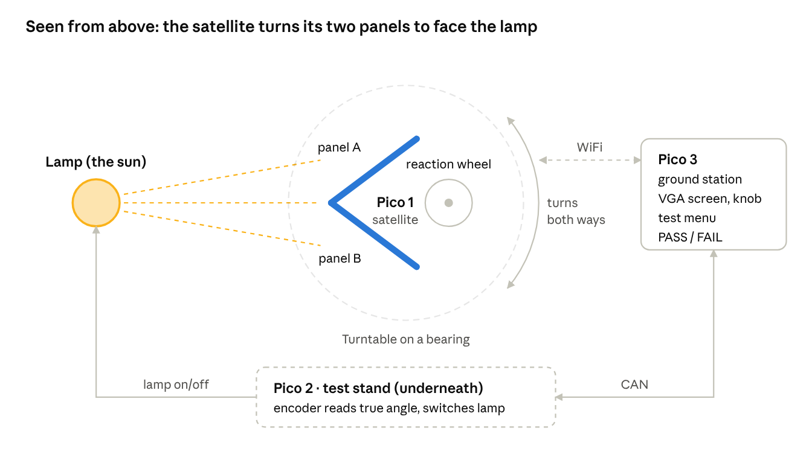
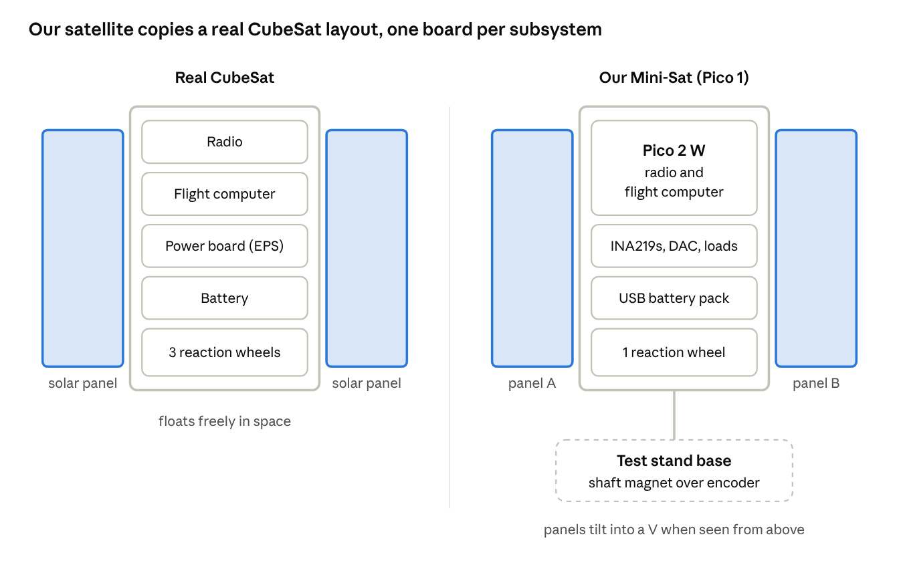

# ECE4760\_Mini-Sat Team Pitch

Snapshot of the live doc, 29 Oct 2026. Diagrams are screenshots; the live doc is linked in README.md.

## The idea in one minute

**We build a tiny satellite that points itself at a lamp "sun", plus the test rig that proves it works.**

- **The satellite** sits on a spinning turntable. It turns by speeding up or slowing down a small flywheel (a reaction wheel). It's the same trick as spinning on an office chair: swing your arms one way and the chair turns the other. Real satellites point this way because in space there's nothing to push against.
- **Two solar panels** are mounted in a V. Whichever panel faces the lamp more squarely makes more power, so the satellite turns until both are equal. The panels are both its power source and its sun sensor.
- **A test stand** under the turntable measures the true angle with a magnetic encoder and can switch the lamp off to make an "eclipse".
- **A ground station** with a VGA screen and a knob shows live data. You pick a test from a menu, it runs, and the screen says PASS or FAIL.

**What the demo looks like:** Hunter spins the satellite by hand and points it away from the lamp. It stops spinning, sweeps around, finds the lamp and locks on. We flip the lamp off and on, cover a panel with cardboard, and push it off course, and each time the screen shows what happened and whether it passed.

Three Pico 2 boards, no laptop needed.

## What it looks like on the bench

The lamp shines more on whichever panel faces it squarely, and the reaction wheel turns the satellite until both panels get the same light.

## Pico 1, built like a real satellite

We build Pico 1 like a CubeSat, a small cube-shaped satellite: a box body with a stack of boards inside, one board per subsystem, and solar panel wings outside. Every real subsystem gets a desk-scale stand-in, and we say clearly what we leave out.

Read across: each layer in our satellite does the job of the same layer in a real one. The Pico 2 W covers two real boards, the radio and the flight computer.

| Real subsystem | What it does | A real small satellite uses | Our Pico 1 uses | What we leave out, and why |
| --- | --- | --- | --- | --- |
| Structure | Holds everything, survives launch | Aluminium cube frame, boards stacked on rods | Foam-board or 3D-printed cube, protoboards stacked on standoffs | Launch-strength frame: nothing shakes it here |
| Power (EPS) | Collects, stores and shares out power | Solar panels, MPPT charger, battery, power switches | 2 solar panels, INA219 sensors, DAC + MOSFET loads running MPPT, USB battery pack | Charging the battery from the panels: we use a software "virtual battery" instead |
| Attitude sensors | Work out which way it's pointing | Sun sensors, gyros, magnetometer, star tracker | Panels as sun sensors, MPU6050 gyro | Star tracker and magnetometer: one axis doesn't need them |
| Attitude actuators | Turn the satellite | 3 reaction wheels, magnetorquers to unload them | 1 reaction wheel on an H-bridge | 2 wheels (we turn on one axis only) and magnetorquers (no Earth magnetic field to push on usefully at a desk) |
| Flight computer | Runs the modes, watches for faults | Radiation-tolerant processor with a watchdog | Pico 2 W running C, with the hardware watchdog | Radiation protection |
| Radio | Sends telemetry, receives commands | UHF or S-band radio, antenna | Pico 2 W built-in WiFi | A real space radio: WiFi stands in for it |
| Thermal | Keeps parts in their safe temperature range | Coatings, heaters, temperature sensors | Nothing extra | Not needed at room temperature |
| Separation switch | Keeps it off until it leaves the rocket | Spring switches pressed by the launcher | Optional: a lever switch that powers it up when lifted off a "launcher" block | — |

**Build ideas that make ours look and act like the real thing.**

- Cube body about 10 cm on a side, the size of a 1U CubeSat, centred on the turntable shaft.
- Boards stacked inside like a real CubeSat: Pico 2 W on top, power board in the middle, battery pack below, reaction wheel at the bottom on the spin axis.
- Wings tilted 35° into a V (seen from above), hinged so they fold flat for transport, like deployable panels.
- A "remove before flight" tag on the power jumper, and the separation switch, so power-up looks like a real deployment. Both are cheap and make a good moment in the demo video.
- Keep it balanced: equal weight on both wings, battery and wheel on the centre line.

## Why it's the best idea

It scores well on every part of the grade, it can't end in an empty demo, and it looks great on a résumé.

| Graded on | Weight | How Mini-Sat does on it |
| --- | --- | --- |
| Final report | 40% | The test stand generates our Results section for us: plots, measured numbers, PASS/FAIL tables. The handout asks for "any and all test data", and testing is literally what this project does. |
| Final demo | 30% | Physical, visual and interactive: a thing that moves on its own toward light, with a screen that explains what it's doing. The handout wants "appropriate hardware/software complexity" and "external hardware and C": we have 3 Picos and about 8 external parts, all in C. |
| Weekly progress | 20% | Every week ends with new tests that run and pass, so there's always something concrete to show at checkoff. |
| Proposal feedback | in progress grade | Hunter checks scope, safety and hardware/software balance. All three are covered: tiered scope, low voltage only, an even hardware/software split. |

**It can't end in an empty demo.** The work is a catalogue of separate tests, and each one works on its own. If we run out of time at test 6, we still have a working satellite and 6 passing tests. Projects that only work when everything works are the ones that fail at demo day.

**It's a real engineering story, not a toy.** After a real satellite leaves the rocket, its first job is to stop tumbling, find the Sun and start charging. Companies building small satellites test exactly this on the ground with automated test rigs. That makes the project easy to explain in an interview: aerospace, embedded systems, controls, power electronics and test engineering are all in one project.

**Everyone learns something they can talk about.** Control loops (PID), solar power (maximum power point tracking), wireless and CAN networking, VGA graphics, and test automation. Each of us can own a piece and explain it fully at the demo.

**It's fun.** Watching something find the light by itself is satisfying, and "cover a panel and see what it does" is a great moment for the demo video.

## How it reuses what we already built

Most of the hard pieces are things we already got working in Labs 1–3 or that Hunter gives us as demos. The new work is mostly connecting them.

| Part of Mini-Sat | Where we already did it | What's new |
| --- | --- | --- |
| Reaction wheel speed control (PWM) | Lab 3 motor PWM | Spin both ways with an H-bridge instead of one MOSFET |
| Gyro reading (MPU6050 over I2C) | Lab 3 IMU, `Sensors/MPU6050_IMU_Demo` | Use the turn rate around the vertical axis |
| PID pointing loop | Lab 3 helicopter PID | Error comes from the panels instead of the IMU angle |
| DAC over SPI (MCP4822) | Lab 1 birdsong, Lab 2 audio | Sets the solar panel loads instead of making sound |
| VGA screen | Lab 2 Galton board, `VGA_Graphics` demos | Draw text, numbers and a menu instead of balls |
| Knob + button menu | Lab 2 rotary encoder | Scroll a list of tests |
| Protothreads and multicore | Labs 1–3 | Same pattern |
| WiFi between Picos | `WiFi/UDP` course demo | One Pico runs as the access point |
| CAN bus | `Networking/CAN` course demo | Check it runs on the Pico 2 |
| INA219 power sensors, AS5600 encoder | Same I2C as the IMU | Small new drivers: read a few registers |
| Solar panels, MPPT | New | About 15 lines: nudge the load, keep the direction that raised power |

The things that are genuinely new are small and well-documented: two I2C sensor drivers, the MPPT loop, and the test menu.

## How we build it

We build one test at a time, and each one is a small, checkable step. The ground station shows a menu of tests; tests we haven't written yet show as NOT BUILT. Every week, more of the list turns into PASS.

| Week | We get working | Tests that pass |
| --- | --- | --- |
| 1 | Turntable spins freely; wheel spins both ways; encoder and gyro read; first WiFi and CAN messages | T01 link check, T02 encoder vs. gyro |
| 2 | Wheel PID turns the satellite to an angle we choose | T03 point to angle |
| 3 | Panels: power sensors, load sweep, MPPT, find the lamp, stay on it | T04 I-V sweep, T05 MPPT, T06 sun acquisition, T07 sun hold |
| 4 | Ground station menu and report page; lamp switch | T08 eclipse, T09 shaded panel |
| 5 | Solder onto protoboard; collect data; report and video | Extra tests only if there's time |

**Who could own what.** Each person owns one Pico, so we can work in parallel and only meet at the messages between boards.

| Owner | Pico | Builds | Can explain at the demo |
| --- | --- | --- | --- |
| Person A | Satellite | Wheel, gyro, PID, sun pointing | How a reaction wheel turns a satellite; PID tuning |
| Person B | Satellite power + test stand | Panels, power sensors, MPPT, encoder, lamp switch | How MPPT finds a panel's best power; true-angle measurement |
| Person C | Ground station | VGA screens, knob menu, WiFi and CAN links, test runner | How the test catalogue works; networking |

We agree on one shared header file in week 1 that defines the messages between the boards. After that, each person can test their board alone. The report's "tasks carried out by each member" appendix then writes itself.

## Why it's not too much work

The project is sized to fit the time the course already expects, and it has a small guaranteed version with optional extras on top.

**The time is there.** The handout expects about 16–20 hours per person per week for 4–5 weeks, with no other assignments. For three people that is roughly 190–300 hours in total. Each person owns one Pico and works in parallel.

**Three levels, and we only promise the first.**

| Level | What it includes | Is that a good project on its own? |
| --- | --- | --- |
| Minimum | Satellite turns to an angle with the wheel; finds and holds the lamp with 2 panels; ground station runs 5 tests | Yes: it moves, it senses, it's tested |
| Core (the plan) | Adds MPPT, eclipse, shaded-panel tests, full menu and report page | Yes: the full story |
| Stretch | Watchdog, lost-link, packet checks, lost-in-space recovery, long soak run | Only if we're ahead |

**Nothing exotic.**

- No custom PCB to order and wait for: breadboard, then a soldered protoboard.
- No mains voltage: a 12 V lamp and a USB battery pack.
- No custom radio: the Pico 2 W's built-in WiFi.
- Cheap: roughly $65–140 in parts we'd buy (an estimate to check), and much of the rest is already in the lab.

**Risks, and what we do if they happen.**

| If this goes wrong | We do this |
| --- | --- |
| CAN demo doesn't run on the Pico 2 | Use a plain UART wire instead; CAN becomes a stretch goal |
| Lamp too weak for the panels | Move it closer or use a brighter halogen; we measure this in week 1 |
| WiFi between two Picos is fiddly | It's the first thing we try in week 1, so we know early |
| PID is hard to tune | We already tuned one in Lab 3; same method |
| Run out of time | Stop at whichever test we've reached; the demo still works |

## Decisions for today

- [ ] Are we going with Mini-Sat?
- [ ] Who owns which Pico (satellite, power + test stand, ground station)?
- [ ] Which parts do we order this week? Solar panels, INA219s, AS5600, motor driver, CAN transceivers, lamp, bearing
- [ ] Who checks what the lab already has (Pico 2 W boards, motors, MOSFETs)?
- [ ] Who drafts which part of the proposal? The full draft is in the Mini-Sat Final Project Proposal doc

Full proposal draft: [ECE4760\_Mini-Sat Final Project Proposal](https://claude.ai/artifact/W9TnAD1FCV8HWrH9HiFUyB)
